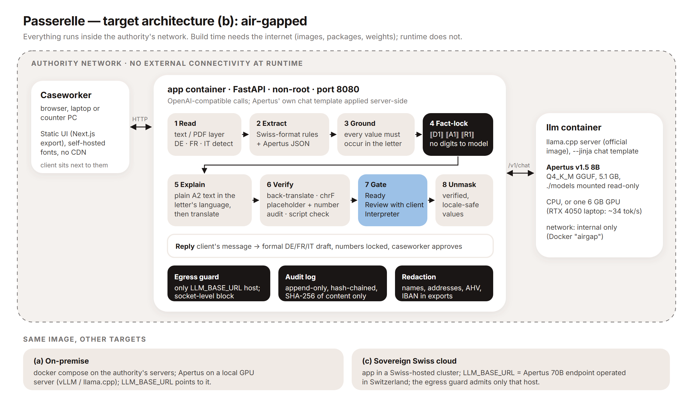

# Passerelle

**Every letter, understood. In every language. Without leaving the building.**

Passerelle ("footbridge") is a sovereign caseworker assistant built on **Apertus v1.5 8B**, Switzerland's open
multilingual model. A caseworker pastes or uploads an official letter in German, French or Italian; Passerelle
extracts a fact card (deadlines, CHF amounts, references, documents, consequences), explains the letter in plain
language in the client's language — Tigrinya, Arabic, Dari, Ukrainian, Tamil, Turkish, Somali, Albanian and more —
verifies the explanation with a back-translation, and tells the caseworker whether it is **Ready**, needs
**Review with the client**, or needs a **human interpreter**. It runs air-gapped on a laptop GPU.

Hack Apertus 2026 · Track 2B (own project) · Team **Stack Underflow** · target architecture **(b) air-gapped**
(also deployable on-premise (a) and in a sovereign Swiss cloud (c)).

## Why

Municipal social services, migration offices and asylum centres send letters whose deadlines and amounts matter:
a missed objection period in a debt-collection order or a missed social-assistance appointment has real
consequences. Many recipients do not read German, French or Italian well; professional interpreting is scarce and
expensive, and public cloud LLMs are not acceptable for this data (special categories of personal data, Swiss FADP,
asylum status). Small open models are good enough to *explain* — but they mistranslate and invent numbers. Passerelle
is built around that failure mode.

## How it works

1. **Read** — text or PDF text layer; DE/FR/IT detection.
2. **Extract** — deterministic Swiss-format extractors (dates like `15.11.2026` / `1er décembre 2026`, `CHF 1'250.50`,
   `Fr. 80.–`, CH IBAN, AHV/AVS `756.xxxx.xxxx.xx`, references, phones, times, relative deadlines `innert 30 Tagen`)
   **plus** Apertus JSON extraction (roles, letter type, action, documents, consequences). Every Apertus value must
   be found in the letter, otherwise it is dropped and flagged.
3. **Fact-lock** — every critical fact is replaced by a placeholder (`⟦D1⟧`, `⟦A1⟧`) before generation; Apertus
   never sees the digits.
4. **Explain** — Apertus writes a CEFR-A2 explanation (what is this / what must you do / by when / what if not / who
   helps) in the letter's language, then translates it into the client's language (RTL-aware).
5. **Verify** — Apertus back-translates; we compute chrF against the plain-language source, audit placeholders
   (missing / duplicated / invented), look for numbers that are not in the letter, and check the script/language.
   A per-language **confidence gate**, calibrated on a dev split, decides Ready / Review / Interpreter.
6. **Unmask** — placeholders become verified, locale-safe values (`15.11.2026`, `CHF 1'250.50`).
7. **Reply** — the client answers in their language; Passerelle drafts a formal reply in the authority's language
   with the reference and numbers locked, for the caseworker to approve.
8. **Privacy** — egress guard (only `LLM_BASE_URL`), hash-chained audit log without content, redaction for exports.



## Results (Apertus v1.5 8B Q4_K_M on an RTX 4050 Laptop GPU)

<!-- auto:RESULTS_TABLE -->
| Metric (test split) | Naive Apertus | Passerelle |
|---|---|---|
| Critical facts rendered exactly, 8 low/mid-resource languages | 54% | **87%** |
| Critical facts rendered exactly, all 10 languages | 55% | **89%** |
| Outputs with a number not in the letter | 2.5% | 1.7% |
| Fact extraction micro-F1 (rules / Apertus / merged) | – | 99.1% / 79.2% / **98.9%** |
| Bad outputs flagged by the gate (recall / precision) | – | 100% / 61% |
| Seconds per letter and language (RTX 4050 laptop) | – | ~32 s |

<!-- /auto:RESULTS_TABLE -->

Full protocol, per-language tables and limitations: [`track_2b/technical_report.md`](track_2b/technical_report.md)
· figures in `track_2b/docs/figures/` · raw outputs in `track_2b/data/eval_runs/`.

## Run it

All commands from `track_2b/`.

**Judges / hosted endpoint (Docker)** — any OpenAI-compatible endpoint serving Apertus:

```bash
export LLM_NAME=swiss-ai/Apertus-v1.5-8B LLM_BASE_URL=https://<endpoint>/v1 LLM_API_KEY=<key>
make run            # = docker compose up --build  ->  http://localhost:8080
```

**Air-gapped (target architecture b)** — llama.cpp server + Apertus GGUF in Docker, internal network only:

```bash
make model          # build time only: downloads the 5.1 GB Q4_K_M GGUF into ./models
make run-local      # CPU   (docker compose --profile local-llm up --build)
make run-local-gpu  # NVIDIA GPU (profile local-llm-gpu)
```

**Without Docker (development)** — Python 3.12 + [uv](https://docs.astral.sh/uv/):

```bash
uv sync
# real model via Ollama (see serving/README.md) ...
export LLM_BASE_URL=http://127.0.0.1:11435/v1 LLM_NAME=apertus-8b
# ... or the mock OpenAI-compatible server (no GPU):  uv run python -m eval.mock_llm --port 8099
uv run passerelle serve --port 8080
```

**Tests and evaluation**

```bash
make test           # 144 unit / property / API-contract tests against a mock LLM (no GPU, no network)
make eval           # full evaluation against LLM_BASE_URL (≈ 3 h on an RTX 4050 laptop)
make report         # technical_report.md -> StackUnderflow_Report.pdf
```

API: `GET /api/health`, `GET /api/languages`, `GET /api/samples`, `POST /api/analyze`, `POST /api/explain`,
`GET|POST /api/explain/stream` (SSE), `POST /api/reply`, `GET /api/audit`, `POST /api/redact`, `POST /api/ingest`
— interactive docs at `/docs`.

## Repository structure (Hack Apertus template)

This repository follows the Hack Apertus project template; the competition directory is `track_2b/` (kept as is).

| Path | What it is |
| --- | --- |
| `README.md` | This overview |
| `LICENSE` | Apache-2.0 (code) |
| `.github/workflows/ci.yml` | CI: tests, Docker build, compose smoke test against a mock LLM |
| `track_2b/README.md` | The challenge description and submission requirements (unchanged) |
| `track_2b/technical_report.md` | The technical report (+ `StackUnderflow_Report.pdf`) |
| `track_2b/Makefile` | `make run` starts the project in Docker |
| `track_2b/src/passerelle/` | FastAPI backend (extraction, fact-lock, explanation, verification, gate, reply, audit, egress, redaction) |
| `track_2b/src/web/` | Next.js UI (static export served by the backend) |
| `track_2b/src/eval/` | Dataset generator, mock LLM, evaluation harness, figures, report builder |
| `track_2b/data/` | Synthetic letters + ground truth, evaluation outputs, HF dataset export (< 100 MB) |
| `track_2b/docs/` | Architecture diagram, figures, prompts |
| `track_2b/serving/` | Local Apertus serving (Ollama Modelfile, template check) |
| `track_2b/tests/` | pytest suite |

## Licences

- Code: **Apache-2.0** (`LICENSE`).
- Documentation, report, figures (`track_2b/docs/`, `technical_report.md`): **CC-BY-4.0** (`track_2b/docs/LICENSE.md`).
- Data (`track_2b/data/`): **CDLA-Permissive-2.0** (`track_2b/data/LICENSE.md`). All letters are synthetic.
- Model: Apertus v1.5 8B (Apache-2.0) by the Swiss AI Initiative. Llama 3 8B (Meta Llama 3 Community Licence) was
  used only as an automatic evaluation judge, never in the product.

## Team

**Stack Underflow** — Yashvardhan Thanvi (BIT Mesra, Off Campus Jaipur, India).

Demo video: https://youtu.be/bjc88UYdgfE
