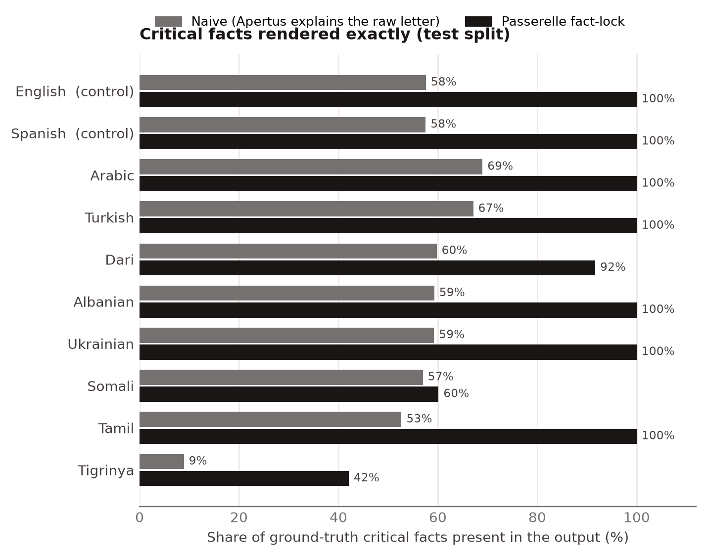
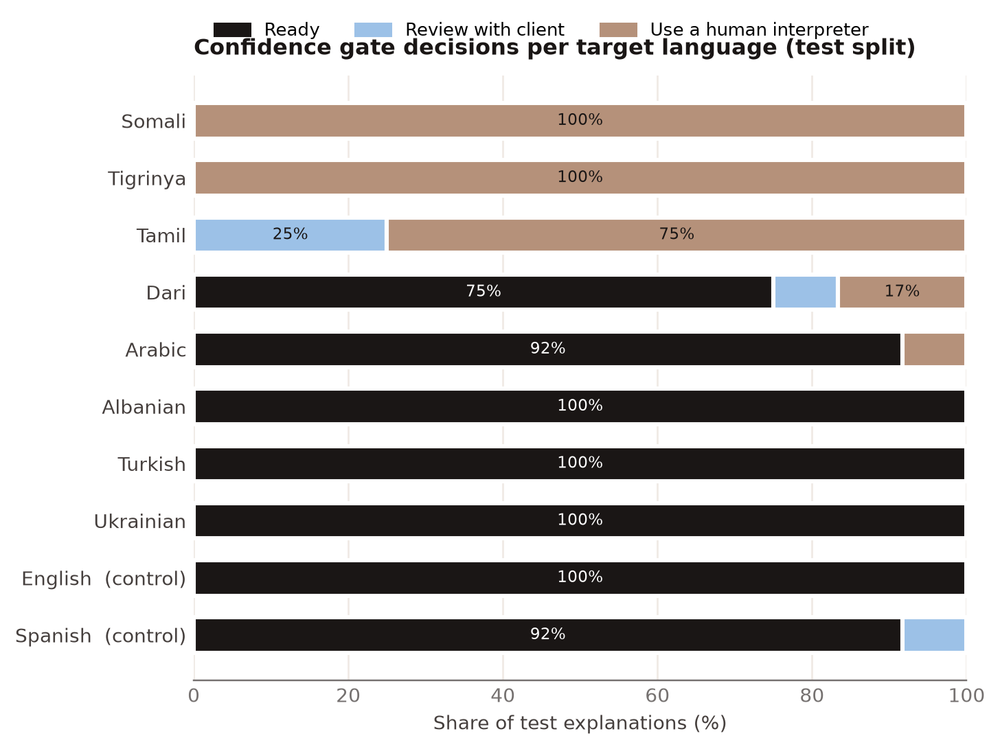

# Technical report — Passerelle

Fact-locked, verified explanations of Swiss official letters in the client's language, with Apertus.

- **Track:** `Track 2B — Passerelle`
- **Event:** Online
- **Team:** Stack Underflow — Yashvardhan Thanvi (BIT Mesra, Off Campus Jaipur, India)
- **Demo:** [https://youtu.be/bjc88UYdgfE](https://youtu.be/bjc88UYdgfE)

## 1. Summary

Swiss authorities write to migrants and asylum seekers in German, French or Italian; a misread deadline or amount
can cost benefits or start debt enforcement, interpreters are scarce, and the data may not leave the authority.
Passerelle is an air-gapped caseworker assistant on **Apertus v1.5 8B** (Q4_K_M, one 6 GB laptop GPU). It extracts a
fact card with deterministic Swiss-format extractors plus Apertus JSON extraction (every model value must be
grounded in the letter), **fact-locks** all critical facts behind placeholders so the model never sees a digit,
has Apertus write a plain-language (CEFR A2) explanation and translate it, verifies it by back-translation (chrF),
placeholder and number audits, and routes each output through a dev-calibrated **confidence gate** (Ready /
Review with client / Use a human interpreter). <!-- auto:HEADLINE_SUMMARY -->On 120 test explanations (12 letters × 10 languages), fact-lock renders **87%** of critical facts exactly in the 8 low/mid-resource languages vs **54%** for naive prompting, and outputs with a number not in the letter are rare either way (2.5% vs 1.7%). The gate flags 100% of bad outputs (precision 61%); one letter in one language takes ~32 s on the laptop GPU.<!-- /auto:HEADLINE_SUMMARY -->

## 2. Architecture

*Figure 1: Components and data flow; everything inside the dashed boundary runs without external connectivity.*

The **app container** (FastAPI, non-root, port 8080) serves the static Next.js UI and the JSON/SSE API
(`src/passerelle/`). Per letter: `ingest` (text or PDF text layer, language detection) → `facts` (deterministic
extractors for 12 fact types: dates in numeric/long DE/FR/IT forms, relative deadlines incl. number words, CHF
amounts in all common Swiss notations, CH IBAN with mod-97, AHV/AVS with EAN-13 check, labelled and patterned
references, Swiss phones, times and ranges, e-mails, URLs, addresses, law articles) → `extract` (Apertus JSON with
schema-constrained decoding; grounding and merge; disagreements surfaced to the caseworker) → `factlock` → `explain`
→ `verify` → gate → unmask. `reply` drafts a formal answer with locked facts; `audit` writes an append-only,
hash-chained log containing SHA-256 hashes and status codes only; `redact` removes names/addresses/IDs for exports;
`egress` allows exactly one outbound host (`LLM_BASE_URL`) both per request and with a process-wide socket guard.
The **llm container** is the official llama.cpp server with the Apertus GGUF mounted read-only. All model access is
through an OpenAI-compatible API (`LLM_NAME`, `LLM_BASE_URL`, `LLM_API_KEY`), so the same image runs against a local
server or a hosted endpoint.

### Target architecture (mandatory)

**We target (b) air-gapped.** `docker compose --profile local-llm up` (or `make run-local[-gpu]`) starts the app
and llama.cpp; the LLM container is attached only to a Docker network with `internal: true` (no route outside), the
app's egress guard admits only the LLM host, fonts and images are self-hosted, and no telemetry is used. The 8B
Q4_K_M model needs 5.1 GB on disk and runs on CPU or a single 6 GB GPU, so it fits a counter PC or a laptop inside
the authority. **(a) On-premise:** the same compose file on the authority's servers with Apertus behind vLLM or
llama.cpp on a local GPU. **(c) Sovereign Swiss cloud:** the app in a Swiss-hosted cluster with `LLM_BASE_URL`
pointing at an Apertus 70B endpoint operated in Switzerland; the egress guard still admits only that host.

*External dependencies.* Build time: Docker base images (`node:22-alpine`, `python:3.12-slim`,
`ghcr.io/ggml-org/llama.cpp`), npm and PyPI packages (hash-pinned `requirements.lock`), and the GGUF from Hugging
Face (`make model`). Runtime: none in air-gapped mode; only `LLM_BASE_URL` in hosted mode.

## 3. Use of Apertus

- **Model:** Apertus v1.5 8B (`swiss-ai/Apertus-v1.5-8B` family), text-only conversion
  `andreasmartin/apertus-v1.5-8b-text`, quantised Q4_K_M GGUF `Colby/apertus-v1.5-8b-text-Q4_K_M-GGUF` (5.06 GB).
- **How it is used:** inference only — structured extraction (JSON), plain-language rewriting, translation into 10+
  target languages, back-translation for verification, and reply drafting. No fine-tuning.
- **Where it runs:** local weights; for development and evaluation Ollama (llama.cpp engine) on an RTX 4050 Laptop
  GPU (6 GB): 33/33 layers on GPU, flash attention, q8_0 KV cache, 4096 context, ~34 tokens/s; in Docker the
  official llama.cpp server with `--jinja`.

**Chat template.** Requests carry only `system` + `user` messages; the server applies Apertus' own template
(`<|system_start|>…<|developer_start|>Deliberation: disabled…<|user_start|>…<|assistant_start|>`). For Ollama we wrote
an equivalent `Modelfile` template and verified it token-for-token against the GGUF's embedded Jinja template
(`serving/verify_template.py`: 55/55 prompt tokens, identical greedy output).

**Prompts** (`docs/prompts.md`, generated from code): English instructions, content fenced as data; the extraction
prompt asks for values "exactly as written" and uses a JSON schema (fallback to `json_object`, tolerant parsing and
one repair round); the explanation prompt gives a typed legend of placeholders ("⟦D2⟧ = a date (deadline)"),
lists the facts the reader must get, and fixes five headings (what is this / what must you do / by when / what if
you do nothing / who helps); translation and back-translation prompts demand verbatim placeholders, the latter a
literal translation that does not repair errors. Decoding: temperature 0.1 (0 for JSON), seed 7.

**Robustness to the 8B model's quirks (measured on the dev letters, fixed before the test run).** Apertus wrote
placeholders as `⟦D3⟩`, `⟦A1⟦` or `[A1]`; unmasking accepts such variants and reports them. It omitted critical
placeholders in the plain-language text, so a deterministic "Key facts" line appends any missing ones before
translation. Low-resource translations sometimes loop ("ዝተወሰነ ዝተወሰነ …"); streaming generation is stopped as
soon as a repetition loop is detected, length is capped relative to the source, and the gate routes such outputs to
an interpreter.

## 4. Data

`data/letters/`: **72 synthetic letters** = 12 letter types (tax reminder, premium reduction, residence-permit
renewal, social-assistance appointment, school enrolment, debt collection, rent increase, AHV/AVS contributions,
family allowance, health-insurance reminder, asylum interview, parking fine) × DE/FR/IT × 2 instances, generated
from 36 hand-written templates by `src/eval/make_letters.py` (seeded). Slots are rendered in varied Swiss formats and
the ground truth (type, surface, normalised value, role, criticality, character spans) is recorded by the generator,
never by the extractors under test. Authorities, places and people are fictional; IBAN/AHV numbers are random with
valid checksums; no personal data. Splits: **dev** = 12 letters (one per type, 4 per language) used only for gate
calibration and prompt debugging; **test** = 60 letters (extraction), of which 12 (one per type, 4 per language)
are used for the GPU-heavy explanation evaluation. Licence CDLA-Permissive-2.0; HF-ready export with dataset card
in `data/hf_dataset/` (evaluation dataset, model responses, instance-level metadata).

## 5. Evaluation

Protocol (`src/eval/`, every model call cached in `data/eval_runs/llm_cache.jsonl`): (1) fact extraction on the 60
test letters for rules only, Apertus only and merged; (2) the key ablation on 12 test letters × 10 target languages —
**naive** (Apertus explains the raw letter in the target language, explicitly told to include all dates, amounts and
references) vs **Passerelle fact-lock**; a fact counts as preserved only if a verifiable rendering appears in the
output (numeric date forms or day + month name + year in the source, English or target language; amounts with any
Swiss separators; digit-exact IBAN/AHV/phones/references); a *hallucinated number* is a ≥ 2-digit number that cannot
be traced to the letter; (3) meaning preservation: chrF(back-translation, plain-language source), plus a helper judge
(Llama 3 8B via Ollama — another open model, used only as an evaluation judge) scoring the round trip 1–5; (4) gate:
thresholds calibrated on dev only; an output is *bad* if it is degenerate, in the wrong script/language, or judged
≤ 2; (5) cost and speed from the logged latencies, token counts and sampled GPU power.

<!-- auto:EVAL_TABLES -->
### Fact extraction

| Setup (test, 60 letters) | Precision | Recall | F1 | Deadline role acc. |
|---|---|---|---|---|
| Rules only | 99.5% | 98.7% | 99.1% | 75% |
| Apertus only | 88.3% | 71.9% | 79.2% | 75% |
| **Merged (ours)** | 98.7% | 99.1% | 98.9% | 80% |

*Table 1: Fact extraction (micro over 9 fact types). Letter type: keyword baseline 82%, Apertus 95%; Apertus returned valid JSON for 60/60 letters.*

### Fact preservation, hallucinated numbers, meaning, gate

| Target language | Facts naive | Facts fact-lock | Halluc. naive | Halluc. fact-lock | chrF median | Judge | Ready / Review / Interp. |
|---|---|---|---|---|---|---|---|
| Arabic | 69% | **100%** | 0% | 0% | 75.4 | 4.25 | 92% / 0% / 8% |
| Dari | 60% | **92%** | 0% | 0% | 67.9 | 3.92 | 75% / 8% / 17% |
| Somali | 57% | **60%** | 17% | 17% | 38.8 | 2.33 | 0% / 0% / 100% |
| Albanian | 59% | **100%** | 8% | 0% | 76.6 | 4.33 | 100% / 0% / 0% |
| Tamil | 53% | **100%** | 0% | 0% | 42.3 | 3.00 | 0% / 25% / 75% |
| Tigrinya | 9% | **42%** | 0% | 0% | 0.0 | 1.42 | 0% / 0% / 100% |
| Turkish | 67% | **100%** | 0% | 0% | 70.1 | 4.08 | 100% / 0% / 0% |
| Ukrainian | 59% | **100%** | 0% | 0% | 72.3 | 4.17 | 100% / 0% / 0% |
| English (control) | 58% | **100%** | 0% | 0% | 77.0 | 4.50 | 100% / 0% / 0% |
| Spanish (control) | 58% | **100%** | 0% | 0% | 76.4 | 4.50 | 92% / 8% / 0% |
| **8 low/mid-resource** | 54% | **87%** | 3% | 2% | 63.9 | 3.44 | 58% / 4% / 38% |
| **2 controls** | 58% | **100%** | 0% | 0% | 77.0 | 4.50 | 96% / 4% / 0% |
| **All** | 55% | **89%** | 2% | 2% | 67.9 | 3.65 | 66% / 4% / 30% |

*Table 2: Explanation ablation on the test split (12 letters per language). Facts = share of ground-truth critical facts rendered exactly; Halluc. = outputs containing a number not in the letter; judge = helper-judge round-trip score (1–5).*

*Figure 2: Share of critical facts rendered exactly, naive vs fact-lock, per target language (test).*

*Figure 3: Gate decisions per target language (test).*

| Gate (test) | Flagged precision | Flagged recall | Interpreter recall | Bad outputs marked Ready |
|---|---|---|---|---|
| With language floors | 61% | 100% | 100% | 0 of 79 |
| Thresholds only | 62% | 100% | 100% | 0 of 80 |

*Table 3: Gate quality. Bad = degenerate or wrong-script output, or judge ≤ 2 (21% of test outputs). Calibrated on dev: review below chrF 51.5, ready from 55.0.*

### Cost and speed

| Step (per call) | Seconds | Completion tokens | Tokens/s |
|---|---|---|---|
| Extraction (JSON), once per letter | 13.4 | 384 | 28.8 |
| Plain-language text, once per letter | 5.1 | 135 | 26.3 |
| Translation, per language | 7.5 | 220 | 29.4 |
| Back-translation, per language | 6.0 | 192 | 32.1 |
| Naive baseline (comparison) | 7.1 | 201 | 28.4 |

*Table 4: Speed on the RTX 4050 Laptop GPU. One letter in one language end to end: ~32 s; GPU energy ≈ 0.38 Wh (≈ CHF 0.0001 at an assumed CHF 0.3/kWh; laptop amortisation ≈ CHF 0.003). For orientation only, community interpreting is assumed to cost CHF 50–130 per hour (assumption, not a cited tariff).*

<!-- /auto:EVAL_TABLES -->

**Findings.** (i) Fact-lock removes the main failure of naive prompting: the naive explanations *dropped or garbled*
between a third and a half of the critical facts in every language (and nearly all in Tigrinya), whereas with fact-lock every
critical fact reached the reader in 7 of 10 languages; invented numbers were rare in both conditions, so the gain
comes from completeness and exactness, not from fewer hallucinations. (ii) The remaining fact losses (Tigrinya,
Somali, one Dari letter) coincide with degenerate or wrong-language translations, which the gate sends to an
interpreter. (iii) Merging rules and Apertus keeps the rules' precision and adds facts with unknown labels; Apertus
alone is weaker on exact copying (it often includes labels or skips long QR references) but much better at letter
type (Table 1). (iv) The gate is deliberately conservative: it caught all bad outputs on test and no output marked "Ready"
was bad, at the cost of sending some acceptable Tamil and Dari outputs to review or an
interpreter.

## 6. Limitations

- **Synthetic, template-based letters.** Real letters are longer, scanned (OCR is out of scope) and messier. The
  deterministic extractors were developed alongside the templates, so their scores are optimistic; we mitigate with
  144 unit/property tests on formats not in the templates, and Apertus grounding recovers unknown labels.
- **Small test set** (12 letters × 10 languages for explanations): per-language numbers have wide confidence
  intervals; per-language thresholds and floors rest on 12 dev items each.
- **Round-trip checks are a proxy.** A wrong translation can back-translate into the right meaning (and vice
  versa); chrF is surface-based and the judge is an 8B model. We saw a case where the Arabic text swapped creditor and
  debtor and chrF stayed high. This is why the gate never certifies correctness — it triages.
- **Language quality is the model's.** For Tigrinya and Somali most outputs are routed to interpreters; Passerelle
  makes that visible but cannot fix it. No native-speaker evaluation was done for the low-resource languages
  (a Tamil spot-check sheet for the team's Tamil reader is prepared in `docs/spotcheck_ta.md`; it had not been completed when this report was generated).
- Only the 8B Q4_K_M model was evaluated; the 70B and other quantisations were not. Unknown reference labels are
  missed when Apertus also misses them (a fact that is not extracted is not locked).

## 7. Reproducibility

Hardware: laptop with NVIDIA RTX 4050 Laptop GPU (6 GB), 16 GB RAM, Windows 11; Ollama 0.34.2 with
`serving/Modelfile` and `serving/serve_ollama.sh`; Python 3.12, `uv.lock`; seed 7, temperature 0.1. Steps:
`python -m eval.make_letters` (seed 2610) → `python -m eval.run_eval extract` → `… explain --langs
ti,ar,prs,uk,ta,tr,so,sq,en,es` → `… judge` → `… calibrate` → `… score` → `python -m eval.figures`; `make eval` chains
them. Re-running reuses the cached model outputs, so all tables are regenerated bit-identically from
`data/eval_runs/`. `make test` runs the 144 tests offline; CI builds the Docker image and smoke-tests `docker compose
up` against a mock OpenAI-compatible server. Prompt version `2026-10-13.1` is recorded with every cached call (`data/eval_runs/run_log.jsonl`).

## 8. Next steps

Native-speaker review of the target languages (with community interpreters) and a human-labelled gate set;
Apertus 70B on a Swiss sovereign endpoint for the weak languages; OCR for scanned letters (Tesseract, on-prem);
glossaries of official terms per language; few-shot or LoRA adaptation of Apertus on plain-language rewriting;
speech output for clients who do not read; a pilot with one municipality's social service.

## License

Creative Commons Attribution 4.0 (CC-BY-4.0). All HackApertus projects are open-sourced. Code: Apache-2.0;
data: CDLA-Permissive-2.0.

## References

1. Swiss AI Initiative. *Apertus: Democratizing open and compliant LLMs for global language environments*, 2025. https://huggingface.co/swiss-ai
2. Popović, M. *chrF: character n-gram F-score for automatic MT evaluation*. WMT 2015.
3. Post, M. *A call for clarity in reporting BLEU scores* (sacrebleu). WMT 2018.
4. Gerganov, G. et al. *llama.cpp*. https://github.com/ggml-org/llama.cpp
5. Federal Act on Data Protection (FADP, SR 235.1), Switzerland, in force since 1 September 2023.
6. Federal Act on Debt Collection and Bankruptcy (SchKG/LP/LEF, SR 281.1), Art. 74 (objection period).
7. Swiss Code of Obligations (OR/CO, SR 220), Art. 270b (contesting rent increases).
8. Meta. *Llama 3 model card*, 2024 (used only as evaluation judge).
